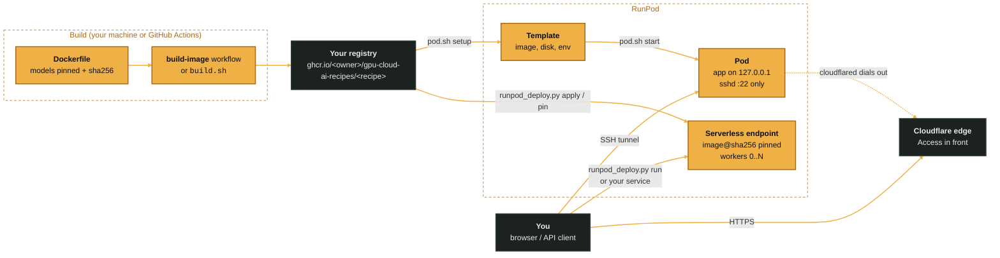

<h1 align="center">
  
  
  
  
  <br>
  <br>
  <code><strong>GPU-Cloud-Ai-recipes</strong></code>
</h1>

<p align="center">
  
  
  
  
</p>

<p align="center">
  Working setups for GPU workloads on rented cloud GPUs.<br>
  Dockerfiles that bake the models in, a CLI that places, reaches and tears down the machines,<br>
  and the notes on provider behavior that the official docs leave out.
</p>

---

## Quick Start

```bash
git clone https://github.com/BitWise-0x/GPU-Cloud-Ai-recipes
cd GPU-Cloud-Ai-recipes/runpod/pods/comfyui-upscale
cp pod.env.example pod.env          # point RUNPOD_IMAGE at your registry
../../pod-kit/build.sh .            # build for linux/amd64 and push, or on GitHub Actions:
# gh workflow run build-image.yml -f recipe=comfyui-upscale -f tag=v1
../../pod-kit/pod.sh . setup        # registry auth + RunPod template
../../pod-kit/pod.sh . start        # place a pod, open the tunnel
../../pod-kit/pod.sh . stop         # billing stops
```

Prerequisites, secrets and the full pod session: [`runpod/README.md`](runpod/README.md).

<br>

---

## Recipes

| Recipe | Kind | What it runs | Models | GPUs |
|---|---|---|---|---|
| [`comfyui-upscale`](runpod/pods/comfyui-upscale/) | Pod | ComfyUI v0.45.2 with two video upscale workflows: per-frame models and SeedVR2 diffusion restore | SPAN, RealPLKSR, Real-ESRGAN, RIFE (baked); SeedVR2 3B (fetched at boot) | 48 GB NVENC cards first (L40, L40S, A6000, 6000 Ada), then RTX PRO 6000; A100, H100, H200 last |
| [`facefusion`](runpod/pods/facefusion/) | Pod | FaceFusion 3.9.2 with its content analyser | swappers, detectors, masks, enhancers (baked) | photo: 16 GB+ cards, cheapest first; video: L40 and L40S first, NVENC cards before A100 and H100 |
| [`whisper`](runpod/serverless/whisper/) | Serverless | scale-to-zero speech to text: audio URL in, text and timed segments out | faster-whisper large-v3 (baked) | 24 GB and 48 GB pools (Ampere, Ada) |

The repo ships Dockerfiles only, never built images. You build each image into
your own registry, which keeps model licenses and image contents under your
control.

<br>

---

## Features

<table>
<tr>
<td valign="top">

### Images


- **Models baked into the image**, pinned and sha256-checked, so a cold start pays for the image pull and never for a download inside billed time. No network volume, so any data center with capacity will do.
- **Model layers that survive code changes**: models download in their own build stage and land as `COPY --link` layers, so a code change never re-downloads or re-pushes them.
- **Broken images fail the build**, not a billed GPU: each image checks its own CUDA stack, encoders and model load at build time, and again at start.
- **Thread pools sized to the CPU quota**, not to the host's core count, so the GPU does not wait on a throttled CPU.

</td>
</tr>
<tr>
<td valign="top">

### Pod kit


- **One CLI for every pod recipe**: `pod.sh <recipe> setup | start | status | tunnel | pause | stop`.
- **Placement that copes with the market**: ordered GPU lists, a vCPU-per-GPU floor, CUDA filters, preferred countries with fallback, retries on capacity errors.
- **Stuck machines detected and replaced**: a pod that shows RUNNING but never starts its container is terminated, its machine remembered and avoided.
- **You stop your pods.** The kit never stops one for you, and every banner says how.

</td>
</tr>
<tr>
<td valign="top">

### Access


- **Nothing published but SSH.** Apps listen on loopback; the kit checks the pod's published ports after every start.
- **SSH tunnel with a watcher** that reopens it on a drop and on a one-way jam.
- **Optional Cloudflare Tunnel** with Access in front: fast uploads, a stable HTTPS hostname, and the token never on a command line or in RunPod's env.

</td>
</tr>
<tr>
<td valign="top">

### Serverless


- **Endpoints from a JSON spec**: `runpod_deploy.py apply | pin | status | run`, standard library only.
- **Digest pinning from CI**, so every push rolls the workers: RunPod does not re-pull a tag.
- **A worker built the way a production one should be**: model loaded at import, input validated at the edge, out-of-memory errors replace the worker.

</td>
</tr>
</table>

<br>

---

## Architecture



<br>

---

## Repository Structure

```
├── runpod/
│   ├── README.md            prerequisites, secrets, a pod session, writing a new recipe
│   ├── pod-kit/
│   │   ├── pod.sh             setup / start / status / tunnel / pause / stop
│   │   ├── build.sh           local linux/amd64 build and push
│   │   ├── lib/common.sh      REST wrapper, placement, tunnel, watcher, Cloudflare
│   │   └── tests/             run the real functions against scripted API answers
│   ├── pods/
│   │   ├── comfyui-upscale/   Dockerfile, start.sh, workflows, custom nodes
│   │   └── facefusion/        Dockerfile, start.sh
│   ├── serverless/
│   │   ├── whisper/           handler, validation, Dockerfile, endpoint spec, CI example
│   │   └── deploy/            runpod_deploy.py
│   └── docs/                GPU selection, images, access, serverless
└── .github/workflows/
    ├── ci.yml               shellcheck, pod-kit tests, Python tests
    └── build-image.yml      build a recipe on a hosted runner and push to GHCR
```

<br>

---

## Docs

| Doc | Covers |
|---|---|
| [GPU selection](runpod/docs/gpu-selection.md) | ordering GPU lists by the job, vCPU floors, CUDA filters, data centers, stuck machines, pause vs. stop |
| [Images](runpod/docs/images.md) | baking models, layer layout, build-time checks, CUDA base images, NVENC, CPU quotas |
| [Access](runpod/docs/access.md) | why pods publish only SSH, the tunnel watcher, setting up a Cloudflare Tunnel with Access |
| [Serverless](runpod/docs/serverless.md) | templates vs. endpoints, releases, digest pinning, GPU pools, cold starts, handler rules |

<br>

---

## License

MIT License, see [LICENSE](LICENSE) for details.

The software and model weights the Dockerfiles download keep their own
licenses, and some are non-commercial or share-alike. Check them before you
use an image beyond personal use.

<br>

---

<p align="center">
  <sub>A <a href="https://bitwise0x.com"><b>BitWise</b></a> product</sub>
</p>
