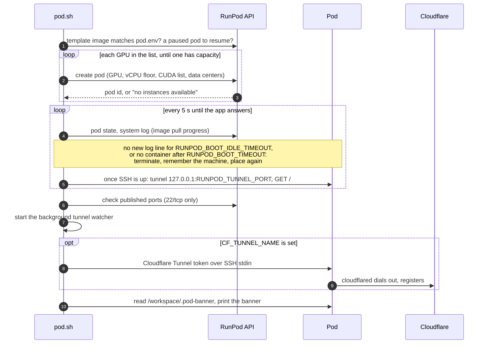

<h1 align="center">
  
  
  
  <br>
  <br>
  <code><strong>RunPod recipes</strong></code>
</h1>

<p align="center">
  GPU pods and serverless workers on <a href="https://www.runpod.io">RunPod</a>,<br>
  with the images built by you and the models baked in.
</p>

---

## Contents

| Path | What |
|---|---|
| [`pod-kit/`](pod-kit/) | `pod.sh`: one CLI that runs any recipe in `pods/` (setup, start, status, tunnel, pause, stop), plus `build.sh` |
| [`pods/comfyui-upscale/`](pods/comfyui-upscale/) | ComfyUI for upscaling old video: per-frame models and SeedVR2 |
| [`pods/facefusion/`](pods/facefusion/) | FaceFusion 3.9.2 with its models baked |
| [`serverless/whisper/`](serverless/whisper/) | a scale-to-zero speech-to-text worker (faster-whisper large-v3) |
| [`serverless/deploy/`](serverless/deploy/) | `runpod_deploy.py`: template and endpoint from a JSON spec, digest pinning, test jobs |
| [`docs/`](docs/) | what decides placement, image layout, access, and how serverless behaves |

<br>

---

## Requirements

| Component | Needed for |
|-----------|------------|
| **RunPod account** | an API key, and **your SSH public key in Settings > SSH Public Keys** (pods are reachable only over SSH) |
| **Registry** | GHCR or Docker Hub, to push your images to |
| **linux/amd64 builds** | Docker with buildx on an x86 machine, or the repo's `build-image` GitHub Actions workflow. RunPod hosts are x86_64; building these CUDA images under emulation on ARM is very slow |
| **bash** | 4.4 or newer (macOS ships 3.2: `brew install bash`) |
| **CLI tools** | `python3`, `curl`, `ssh` |
| **Cloudflare** (optional) | `cloudflared` and a domain on Cloudflare, for the Cloudflare Tunnel ([`docs/access.md`](docs/access.md)) |

<br>

## Secrets

`pod.sh` reads `runpod/.secrets.env` (gitignored), or the file named by
`RUNPOD_SECRETS_FILE`:

```bash
RUNPOD_API_KEY=...
# only for a private image: a read-only registry token
REGISTRY_USER=your-user
REGISTRY_TOKEN=...
```

`setup` stores the registry token in RunPod's registry auth once, and the
template refers to it by id. The API key reaches `curl` as a header file,
never as an argument a process listing would show.

<br>

---

## A Pod Session

```bash
cd runpod/pods/<recipe>
cp pod.env.example pod.env      # edit RUNPOD_IMAGE, GPU lists, ports
../../pod-kit/build.sh .        # build and push a new tag (or: gh workflow run build-image.yml -f recipe=<recipe> -f tag=v2)
../../pod-kit/pod.sh . setup    # registry auth + template (re-run after an image change)
../../pod-kit/pod.sh . start    # or: start <list>, e.g. start video
../../pod-kit/pod.sh . status
../../pod-kit/pod.sh . stop
```

### Commands

| Command | Effect | Billing after |
|---------|--------|---------------|
| `setup` | creates or updates the registry auth and the RunPod template from `pod.env` | none |
| `start [list]` | places a pod (from `RUNPOD_GPU_TYPES`, or `RUNPOD_GPU_TYPES_<LIST>`), opens the tunnel, starts the watcher | GPU + disk |
| `status` | pod state, template and running image (warns on drift), tunnel and watcher state with drop count, ssh and scp lines, published ports, Cloudflare connections | unchanged |
| `tunnel` | reopens the SSH tunnel and watcher for a running pod | unchanged |
| `pause` | stops the pod but keeps its machine; the next `start` resumes there with the image cached | disk only |
| `stop` | terminates the pod | none |

### What `start` does



Placement details (vCPU floors, CUDA lists, country fallback, stuck machines)
are in [`docs/gpu-selection.md`](docs/gpu-selection.md).

### One-run overrides

Any `RUNPOD_*`, `CF_*`, `POD_*` or `REGISTRY_*` value, and any variable under
the recipe's `POD_ENV_PREFIX` (e.g. `COMFYUI_*`), can be overridden for one run
inline. A value from your shell wins over `pod.env`:

```bash
RUNPOD_GPU_TYPES="NVIDIA L40S|NVIDIA L40" ../../pod-kit/pod.sh . start
RUNPOD_MIN_VCPU_PER_GPU= ../../pod-kit/pod.sh . start video
RUNPOD_CLOUD_TYPE=COMMUNITY ../../pod-kit/pod.sh . start
```

> **A pod bills until you stop it.** The kit never stops one for you.

<br>

---

## A New Recipe

A recipe is a directory with a `Dockerfile`, a `start.sh` and a
`pod.env.example`. For it to work with `pod.sh`, the image has to:

| Requirement | Why |
|-------------|-----|
| run sshd with key auth from `PUBLIC_KEY`, and refuse to start without a key | the tunnel is the only way in; a pod nobody can reach still bills |
| have its app listen on `127.0.0.1:POD_APP_PORT` | nothing but SSH is published |
| answer `GET /` with 200 or 302 once ready | `start` waits on it through the tunnel |
| optionally write one line to `/workspace/.pod-banner` | `start` shows it (the ComfyUI recipe reports its video encoder) |
| optionally include `cloudflared` | for the Cloudflare Tunnel |

The two pod recipes show all of it.

<br>

---

## Tests

```bash
for t in pod-kit/tests/test_*.sh; do bash "$t"; done
python3 -m unittest discover -s serverless/whisper/tests
```

The pod-kit tests run the real `pod.sh` functions against scripted API answers.
They never call RunPod. CI runs both, plus shellcheck, on every push.
