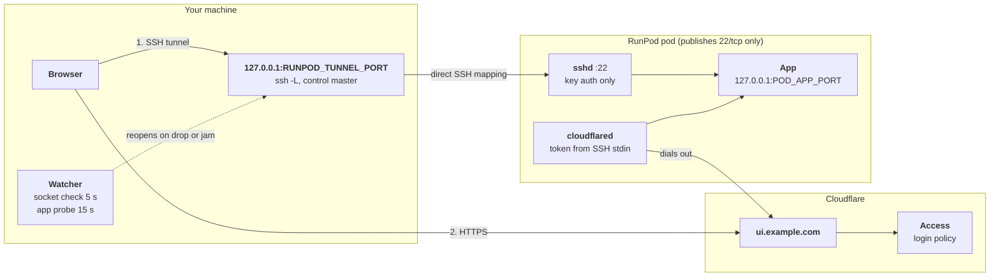

# Reaching a pod: SSH tunnel and Cloudflare Tunnel

The pods publish nothing but SSH. The app inside listens on the container's
loopback, and you reach it in one of two ways:

1. **SSH tunnel** (always on): `pod.sh start` forwards `127.0.0.1:RUNPOD_TUNNEL_PORT`
   on your machine to the app's port inside the pod.
2. **Cloudflare Tunnel** (optional): the pod's `cloudflared` dials out to your
   Cloudflare account, and the app is served at a hostname of yours behind
   Cloudflare Access.



| | SSH tunnel | Cloudflare Tunnel |
|---|---|---|
| **Always on** | yes | only with `CF_TUNNEL_NAME` and `CF_PUBLIC_HOSTNAME` set |
| **Reachable from** | the machine that ran `pod.sh` | any device that passes your Access policy |
| **Login** | your SSH key | Cloudflare Access (one-time PIN, SSO, identity provider) |
| **Large uploads** | slow on some routes; a drop restarts a single-request upload | fast (nearby edge); 100 MB per request on Free and Pro |
| **Address** | `http://127.0.0.1:<port>`, per recipe | a stable HTTPS hostname, whatever pod is running |

<br>

---

## Why not RunPod's HTTP proxy or a public port

RunPod can publish a port as `https://<pod>-<port>.proxy.runpod.net` or as a
direct TCP port on a public IP. Either way, the app is on the internet with no
login in front of it. ComfyUI, FaceFusion and most other GPU web UIs have no
authentication of their own, and they read and write files on the pod. The pod
kit refuses that shape:

- Templates and pods publish `22/tcp` only. After every start, and in `status`,
  the kit reads the ports the pod actually publishes and warns about anything
  else.
- Apps listen on `127.0.0.1` (`COMFYUI_LISTEN`, `FACEFUSION_LISTEN`).
- sshd takes keys only: RunPod injects the SSH public keys from your account
  settings as `PUBLIC_KEY`. A container with no key refuses to start.

<br>

---

## The SSH tunnel

`pod.sh start` opens the tunnel as soon as the pod's SSH answers, waits until
the app answers through it, then starts a background **watcher**:

- Every 5 s it checks the tunnel's control socket. When the tunnel dies, the
  watcher logs why and reopens it as soon as the pod's SSH answers again,
  usually within 5 to 10 s.
- ssh sends a keepalive every 5 s and declares the connection dead after 3
  misses, so a network stall is noticed in about 15 s.
- A tunnel can also jam one way: an upload stalls while the app keeps
  streaming back, so the keepalive never fires. Every 15 s the watcher also
  loads the app through the tunnel, and after three misses in a row it closes
  the tunnel and reopens it.
- Drops and reconnects go to `/tmp/rp-tunnel-<pod name>.events` and are copied
  into the pod at `/workspace/.tunnel-events.log`. The ComfyUI recipe shows
  them in its Logs panel (`connection_events.py`).
- The tunnel sets `IPQoS=throughput`. macOS ssh otherwise marks the traffic as
  interactive, which some routers and Wi-Fi handle badly on long transfers.
- `stop` ends the watcher, and it exits by itself once the pod is gone.

RunPod's SSH gateway (`ssh.runpod.io`) cannot forward ports, so the tunnel
uses the pod's direct SSH mapping (a public IP and port). Each pod generates
new host keys at boot, so there is no key to pin, and the tunnel trusts
whatever answers on that mapping.

<br>

---

## Why add a Cloudflare Tunnel

The SSH tunnel is enough for driving a UI. It is slow for large uploads: an
upload goes from your ISP across the internet into the pod's provider network,
and on some routes that path is far slower than the download path. With a
Cloudflare Tunnel:

- the browser uploads to a Cloudflare edge near you, and the pod pulls from
  Cloudflare at data-center speed;
- you get a stable HTTPS hostname for whatever pod is running, usable from any
  device, with Cloudflare Access (email one-time PIN, SSO, or another identity
  provider) in front of it;
- the pod still publishes nothing: `cloudflared` dials out.

Cloudflare caps one request at 100 MB on the Free and Pro plans. An app that
uploads a large file in one request gets an error above that. The ComfyUI
recipe sends uploads in resumable chunks under that cap (`chunked_upload`).
Upstream FaceFusion sends each upload in one request, so for large files use
`scp` or the SSH tunnel.

<br>

---

## Setting up a Cloudflare Tunnel

You need a domain on Cloudflare and `cloudflared` on the machine that runs
`pod.sh`. The steps below use `ui.example.com` and a tunnel named
`comfyui-pod`; use your own.

1. **Log in once** on your machine: `cloudflared tunnel login`. This writes
   `~/.cloudflared/cert.pem`, which lets `cloudflared` read tunnel tokens for
   your account.
2. **Create the tunnel** in the Cloudflare dashboard: Zero Trust > Networks >
   Tunnels > Create a tunnel > Cloudflared. Name it `comfyui-pod`. Skip the
   connector install step: the pod runs the connector.
3. **Add a public hostname** to the tunnel: `ui.example.com`, service
   `http://localhost:8188` (the app's port inside the pod). For ComfyUI, set
   **HTTP Host Header** (under Additional application settings > HTTP
   Settings) to `ui.example.com`. ComfyUI refuses a POST whose `Host` is
   loopback when its `Origin` is not, and the browser sends the public
   hostname as `Origin`.
4. **Put Access in front of it**: Zero Trust > Access > Applications > Add an
   application > Self-hosted, domain `ui.example.com`, with a policy that
   allows only your email (or your identity provider's group). Without this
   step the UI is public.
5. **Point the recipe at it** in `pod.env`:

   ```bash
   CF_TUNNEL_NAME=comfyui-pod
   CF_PUBLIC_HOSTNAME=ui.example.com
   ```

Use one tunnel and one hostname per recipe, so pods of two recipes can run at
the same time without sharing a connector.

### How the kit runs it

After the app answers through the SSH tunnel, `pod.sh start`:

- runs `cloudflared tunnel token <name>` on your machine and pipes the token
  over SSH stdin into the pod, where `cloudflared tunnel run` reads it from
  its environment. The token never appears on a command line, in the RunPod
  template, in RunPod's env or in any output;
- waits up to 30 s for `Registered tunnel connection` in
  `/workspace/cloudflared.log` on the pod;
- names the Cloudflare address in its banner only once the tunnel holds a
  connection, and says why when it could not connect.

A container restart ends `cloudflared`. The watcher checks it every minute and
after every reconnect, and starts it again when it is gone. `status` shows the
address and how many connections the tunnel holds.

The image only needs the `cloudflared` binary (pinned and checksummed in each
recipe's Dockerfile). With `CF_TUNNEL_NAME` empty, a recipe uses the SSH tunnel
only and the binary does nothing.

<br>

---

## Getting files off the pod

The container disk is wiped when a pod stops or pauses. Copy outputs off first:

```bash
pod.sh <dir> status          # prints the ssh and scp lines for this pod
scp -P <port> root@<host>:/workspace/output/* ./
```

Each app's own download button works too, through the SSH tunnel or the
Cloudflare hostname.
