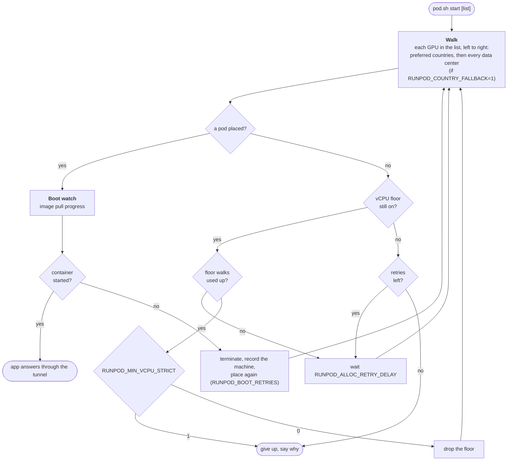

# Picking GPUs on RunPod

What decides which card a pod lands on, and how the pod kit's lists and filters
work around RunPod's placement.

 

---

## The walk at a glance

| Knob | Default in the kit | Effect |
|---|---|---|
| `RUNPOD_GPU_TYPES` (`_<LIST>` for `start <list>`) | per recipe | the cards to try, in order |
| `RUNPOD_MIN_VCPU_PER_GPU` (`_<LIST>`) | per recipe | vCPU floor per GPU for the first walks |
| `RUNPOD_MIN_VCPU_WALKS` | `9` | walks with the floor before it is dropped or start gives up |
| `RUNPOD_MIN_VCPU_STRICT` | per recipe | `1` gives up, `0` drops the floor |
| `RUNPOD_ALLOC_RETRIES`, `RUNPOD_ALLOC_RETRY_DELAY` | `6`, `20` s | walks without a floor, and the wait between walks |
| `RUNPOD_ALLOWED_CUDA_VERSIONS` | per recipe | exact CUDA versions a host may report |
| `RUNPOD_COUNTRY_CODES`, `RUNPOD_COUNTRY_FALLBACK` | per recipe | preferred countries, then everywhere |
| `RUNPOD_BOOT_IDLE_TIMEOUT`, `RUNPOD_BOOT_TIMEOUT`, `RUNPOD_BOOT_RETRIES` | `240` s, `900` s, `2` | when a machine counts as stuck, and how many to replace |
| `RUNPOD_CLOUD_TYPE` | `SECURE` | Secure or Community cloud |

 

---

## Order the list by what the job needs, not by price alone

`pod.sh start` walks `RUNPOD_GPU_TYPES` left to right and takes the first card
with capacity. Each recipe orders its list by what its work needs:

- **A still image or a short job:** the cheapest card with enough VRAM goes
  first. Spare VRAM and CPU cores are wasted money.
- **Video output:** cards with an NVENC encoder go first. On an NVENC card the
  encode runs on the GPU and the CPU cores are left for the rest of the
  pipeline. **A100, H100, H200, B200 and B300 have no NVENC engine**, so video
  on those cards encodes with libx264 on the CPU. They are also the most
  expensive cards. They belong at the end of a video list, to catch a start
  when nothing else is free. `pod-kit/tests/test_gpu_lists.sh` checks this
  order in every recipe.
- **VRAM:** measure one job on the card (`nvidia-smi` on the pod) and leave
  headroom. A list of cards that all fit is better than one large card that is
  often sold out.

The exact GPU names come from `GET https://api.runpod.io/v2/catalog/gpus`.

 

---

## The same GPU type comes with different CPUs

A GPU type does not fix the CPU. The same L40S can come with 16 vCPUs on one
host and 32 on another, and the container is capped at a cgroup quota below
the host's count. For work where the CPU does part of every frame (face
detection, masks, video decode), a 16-vCPU host can pin its CPU while the GPU
waits. On such a job the gap between two hosts with the same GPU can be close
to 2x.

`RUNPOD_MIN_VCPU_PER_GPU` asks RunPod for hosts with at least that many vCPUs
per GPU (`gpu.minVcpuCountPerGpu` on pod create). It is a placement filter, so
any host at or above the floor qualifies. The kit walks the list with the floor
for `RUNPOD_MIN_VCPU_WALKS` walks, `RUNPOD_ALLOC_RETRY_DELAY` seconds apart.
After that:

- With `RUNPOD_MIN_VCPU_STRICT=1`, start gives up and says so.
- With `RUNPOD_MIN_VCPU_STRICT=0`, start drops the floor and takes any host.
- `RUNPOD_MIN_VCPU_PER_GPU= pod.sh <dir> start` skips the floor for one run.

**RunPod returns the same "no longer any instances available" error for a
filter no free host meets as for a sold-out card.** If every card in the list
shows no capacity, the cause is usually the vCPU floor, the CUDA list or the
data centers, not an outage. The kit prints RunPod's own message for each
miss so you can tell which.

`docs/images.md` covers how an image should size its thread pools to the
quota, not to the host.

 

---

## CUDA versions

`RUNPOD_ALLOWED_CUDA_VERSIONS` keeps pods off hosts whose driver cannot run the
image's CUDA runtime. For pods, **the list is matched exactly against the CUDA
version the host reports**, so it names every minor the image can run on: a
CUDA 13.0 image lists 13.0 through 13.9, because a newer 13.x driver runs it.
If you leave a minor out, you lose every host that reports it.

A base image newer than the host driver does not fail politely. The NVIDIA
container runtime refuses the container at the prestart hook, the pod never
starts, and the kit reports it as a stuck machine. Pick the base image's CUDA
to match the hosts you want, not the newest release.

Serverless endpoints are different: see `docs/serverless.md`.

 

---

## Data centers and the fallback

`RUNPOD_COUNTRY_CODES` (for example `US,CA`) limits pods to data centers whose
id starts with one of those codes. `dataCenterIds` on pod create acts as a hard
filter: a data center left out is never used. With `RUNPOD_COUNTRY_FALLBACK=1`,
each walk tries the preferred countries first and then every data center, so a
free host abroad is taken in the same walk instead of after every walk at home
has come up empty. Pick the countries for latency to you. Pods are reached
over SSH or a Cloudflare edge near you, so a distant pod costs latency, not
features.

 

---

## Machines that never start

Now and then the scheduler places a pod on a machine that never pulls the
image or never starts the container. The pod shows RUNNING, nothing happens,
and it bills. The kit watches the pod's system log while it waits. If the log
shows no new line for `RUNPOD_BOOT_IDLE_TIMEOUT` seconds, or the container has
not started after `RUNPOD_BOOT_TIMEOUT`, the kit:

1. records the machine in `~/.cache/gpu-cloud-ai-recipes/runpod-hosts`,
2. terminates the pod,
3. places a new one, up to `RUNPOD_BOOT_RETRIES` times.

RunPod's API cannot exclude a machine, so for `RUNPOD_BAD_HOST_HOURS` the kit
places that GPU type outside the stuck machine's data center, and releases at
once any pod that still lands on it. The machine id comes from the SSH proxy
user name (`<pod id>-<machine id>`), the only place the v2 API exposes it.

 

---

## Secure and Community cloud

| `RUNPOD_CLOUD_TYPE` | Hosts | Price | Use for |
|---|---|---|---|
| `SECURE` (default) | RunPod's own data centers | higher | work you are watching |
| `COMMUNITY` | third-party hosts; can be interrupted, network less predictable | lower | work where a restart costs you little |

 

---

## Pause and stop

| | `pause` | `stop` |
|---|---|---|
| **GPU billing** | stops | stops |
| **Disk billing** | continues until `stop` | stops |
| **Machine** | kept: the next `start` resumes on it with the image cached, saving the cold pull | released |
| **Container disk** | wiped | wiped |
| **If the GPU was taken meanwhile** | `start` terminates the paused pod and places a new one | n/a |

Nothing in the kit stops a pod for you. Run `stop` when you are done.
