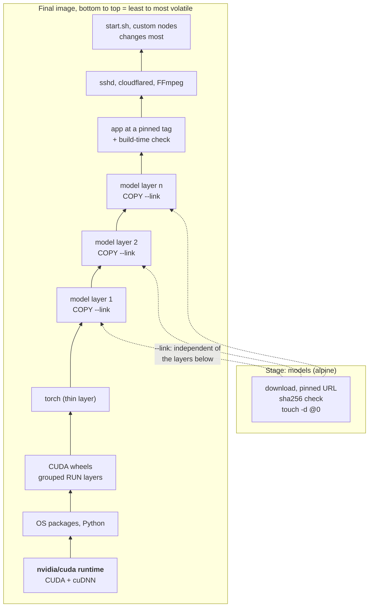

# Building GPU images for RunPod

How the recipes' Dockerfiles are put together, and why. All of it comes down to
two goals: a pod or worker should start fast and not download anything inside
billed time, and a broken image should fail the build, not a billed GPU.

 

---

## Bake the models in

Each recipe downloads its models at build time, into the image:

- A cold start pays for the image pull only, never for a model download inside
  a running, billed container.
- No network volume, so the pod or endpoint is not tied to the one data center
  that holds the volume. Any host with capacity will do.
- Each model is pinned by URL, release tag or commit, and checked with a
  sha256 or a size check. The image always holds the same bytes.

The cost is image size. A recipe can download a model at container start
instead when the model is large and only some sessions need it.
`comfyui-upscale` does this for SeedVR2 (6.8 GB): `start.sh` fetches it in the
background with a pinned commit and sha256, so the fast workflow works at once
and the SeedVR2 one a few minutes later.

A model downloaded into your image is still under its own license. Check the
license before you use the image for anything beyond personal use. These
recipes publish Dockerfiles only, never built images.

 

---

## Layer layout

Layer order and size decide how fast a pod starts and how much each release
pushes:

- **Download models in a separate build stage and `COPY --link` them in.** A
  `--link` layer does not depend on the layers below it, so a change to the
  code or the dependencies never re-downloads or re-pushes the models, and a
  host that pulled the old image keeps those layers.
- **One model per layer, or a few.** Docker extracts each layer as one
  sequential decompress, untar and write. A multi-GB layer can take many
  minutes to extract on a host with a slow disk, while the download itself is
  fast. Several smaller layers pull in parallel and extract in parallel.
  Registries also cap the size of one layer: GHCR's cap is 10 GB, so a larger
  checkpoint has to be split across several layers.
- **Fixed mtimes** (`touch -d @0`) on downloaded files, so an identical
  re-download produces the same layer digest and nothing is pushed again.
- **Least volatile first:** base and CUDA libraries, then models, then the
  app, then the scripts that change most.
- **torch's CUDA wheels in their own layers.** The torch wheel declares its
  CUDA libraries as pip dependencies, and installing `torch` in one `RUN`
  resolves all of them into a single multi-GB layer. `comfyui-upscale`
  pre-installs the CUDA wheels in four grouped `RUN`s at torch's exact pins,
  then installs torch on top, where it is a thin layer.
  `verify-torch-deps.py` fails the build when a torch bump changes one of
  those pins, because torch would then pull a second copy into its own layer
  and undo the split.

 

---

## Fail the build, not the pod

Every recipe checks its own stack while building:

| Recipe | Build-time check | Catches |
|---|---|---|
| `comfyui-upscale` | ComfyUI starts with `--quick-test-for-ci --cpu`; the build fails on `IMPORT FAILED` | a custom node or dependency that does not import |
| `comfyui-upscale` | `verify-torch-deps.py` compares the pre-installed CUDA wheels with torch's pins | a torch bump that would pull a second copy of the CUDA libraries |
| `facefusion` | onnxruntime has the CUDA execution provider, only the GPU wheel is installed, and the version is outside a range known to leak memory | a CPU wheel shadowing the CUDA build; a leaking release |
| `whisper` | decodes a generated WAV, then loads the model on the CPU | a decoder library that broke its API; a missing or corrupt model |
| all with video | FFmpeg lists the encoders the app needs (`h264_nvenc`, `libx264`) | an FFmpeg build without them |

At start, `start.sh` repeats the check that needs a GPU, then refuses to run
when CUDA is missing. An app that falls back to the CPU on a billed GPU pod
is worse than one that exits.

 

---

## CUDA base image

Pick the base image's CUDA for the hosts you want, not the newest release.
NVIDIA's runtime images refuse to start on a driver older than their CUDA
version, at the container prestart hook, before any of your code runs.
`docs/gpu-selection.md` covers matching it with `RUNPOD_ALLOWED_CUDA_VERSIONS`.

`NVIDIA_DRIVER_CAPABILITIES=compute,utility,video` is needed for NVENC: the
container runtime mounts only the driver libraries a capability asks for, and
the CUDA images ask for compute and utility only.

Ubuntu 22.04's apt FFmpeg is 4.4, too old for some current apps (FaceFusion
passes `-fps_mode`, added in 5.1). The recipes use a pinned BtbN static build,
checked by sha256, which loads NVENC from the driver at runtime. Match the
build's NVENC API level to the hosts' drivers: a build that asks for a newer
API than the host driver offers cannot encode.

 

---

## CPU quota and thread pools

A container sees every CPU on the host (`nproc` can report 128) but runs on a
cgroup quota of a few dozen vCPUs. torch (OpenMP), OpenCV and onnxruntime size
their thread pools to the CPUs they can see. Hundreds of busy threads on a
small quota get throttled every scheduling period, and the GPU waits for them.
Signs: `nr_throttled` climbing in `/sys/fs/cgroup/cpu.stat`, and low GPU use.

- Read the quota from `/sys/fs/cgroup/cpu.max` and set `OMP_NUM_THREADS` and
  `OPENCV_FOR_THREADS_NUM` from it (`comfyui-upscale/start.sh`).
- When the app runs several workers of its own, give each one thread
  (`OPENCV_FOR_THREADS_NUM=1` in `facefusion/start.sh`).
- onnxruntime sizes each session's intra-op pool to the host's physical cores
  unless the app sets `SessionOptions`. Check whether your app does. If it
  does not, throttling shows up as low GPU use with all cores busy.

 

---

## Access from inside the image

The pod images run `sshd` (key auth only, from the `PUBLIC_KEY` RunPod
injects), with the app listening on loopback. Host keys are deleted at build
time, so every pod generates its own. `start.sh` refuses to start without a
key, because a pod nobody can reach still bills. `docs/access.md` covers the
rest.
