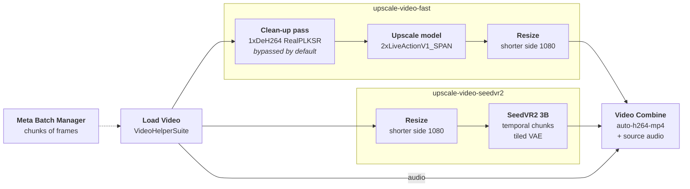

<h1 align="center">
  
  
  
  
  <br>
  <br>
  <code><strong>comfyui-upscale</strong></code>
</h1>

<p align="center">
  
  
  
  
</p>

<p align="center">
  ComfyUI on a RunPod GPU pod, set up for upscaling old, low-resolution video:<br>
  camcorder and VHS captures, DVD rips, small web video.
</p>

---

## Quick Start

```bash
cd runpod/pods/comfyui-upscale
cp pod.env.example pod.env          # set RUNPOD_IMAGE to your registry
../../pod-kit/build.sh .            # build for linux/amd64 and push
../../pod-kit/pod.sh . setup        # registry auth + RunPod template
../../pod-kit/pod.sh . start        # allocate, wait, open the tunnel
# open http://127.0.0.1:18288, load a workflow from the Workflows panel,
# upload a clip, queue it
../../pod-kit/pod.sh . stop         # billing stops
```

Outputs land in `/workspace/ComfyUI/output/` as `upscaled-*-audio.mp4`.
Download them from the UI's queue, or with `scp` (`pod.sh . status` prints
the command), before you stop the pod.

<br>

---

## Workflows

Two workflows are baked in and show up in the Workflows panel.

| Workflow | What it does | Speed | Use for |
|---|---|---|---|
| `upscale-video-fast` | per-frame upscale model (SPAN, RealPLKSR, Real-ESRGAN), optional H.264 clean-up pass, resize to the output height | fast | whole films |
| `upscale-video-seedvr2` | SeedVR2 diffusion restore: redraws detail with temporal consistency | slow | short clips and the shots that matter |



Both process the video in chunks of frames (VideoHelperSuite's Meta Batch
Manager), so a film never sits in RAM at once, and encode with the source
audio. The encode uses `h264_nvenc` when the GPU has an encoder and falls
back to `libx264` when it does not: `start.sh` picks one at boot and writes
the `auto-h264-mp4` format the workflows use.

<br>

---

## What Is in the Image

| Component | Version / detail |
|---|---|
| **ComfyUI** | v0.45.2, core nodes plus VideoHelperSuite 1.7.9 |
| **torch** | 2.14.1 + CUDA 13.0 (cu130), Python 3.12 |
| **Upscale models** (baked, sha256-checked) | 2xLiveActionV1_SPAN, 2xVHS2HD-RealPLKSR, 1xDeH264_realplksr, RealESRGAN x2plus / x4plus, realesr-general-x4v3, RIFE 4.26 (frame interpolation) |
| **SeedVR2** | downloaded at boot (3B fp16 by default, sha256-checked); `COMFYUI_SEEDVR2_MODEL` picks another or `none` |
| **FFmpeg** | 8.1 with NVENC, for VideoHelperSuite |
| **`chunked_upload` node** | browser uploads go in resumable chunks: they survive a dropped tunnel and stay under Cloudflare's 100 MB request cap |
| **`connection_events.py`** | shows the SSH tunnel's drops and reconnects in ComfyUI's Logs panel |
| **sshd, cloudflared** | access ([`docs/access.md`](../../docs/access.md)) |

> **Licenses:** the upscale models carry their own licenses, listed in the
> Dockerfile. Some (SPAN, VHS2HD) are non-commercial or share-alike.

SeedVR2 (6.8 GB) is the one model not baked: `start.sh` fetches it in the
background at a pinned commit, so the fast workflow works at once and the
SeedVR2 one a few minutes later. [`docs/images.md`](../../docs/images.md)
covers that tradeoff.

<br>

---

## Configuration

Set in `pod.env` (copied from [`pod.env.example`](pod.env.example), which
documents every value):

| Variable | Example value | Purpose |
|---|---|---|
| `RUNPOD_IMAGE` | `ghcr.io/your-user/gpu-cloud-recipes/comfyui-upscale:v1` | the image you built |
| `RUNPOD_POD_NAME`, `RUNPOD_TEMPLATE_NAME` | `comfyui-upscale-pod` | pod and template name in your account |
| `POD_APP_PORT` | `8188` | ComfyUI's port inside the pod |
| `RUNPOD_TUNNEL_PORT` | `18288` | the local end of the SSH tunnel |
| `RUNPOD_CONTAINER_DISK_GB` | `120` | container disk: the image, SeedVR2, inputs and outputs |
| `RUNPOD_GPU_TYPES` | NVENC cards first (L40, L40S, A6000, ...), A100 / H100 / H200 last | GPU list, walked left to right |
| `RUNPOD_MIN_VCPU_PER_GPU` | `16` | vCPU floor for the first walks, then dropped (`RUNPOD_MIN_VCPU_STRICT=0`) |
| `COMFYUI_SEEDVR2_MODEL` | `seedvr2_3b_fp16.safetensors` | SeedVR2 checkpoint fetched at boot, or `none` |
| `CF_TUNNEL_NAME`, `CF_PUBLIC_HOSTNAME` | empty | optional Cloudflare Tunnel ([`docs/access.md`](../../docs/access.md)) |

Any `COMFYUI_*` value is passed into the pod through the template.

<br>

---

## Tips

| Situation | What to do |
|---|---|
| Source has no audio track | Load Video fails ("failed to extract audio"): disconnect the audio link into Video Combine |
| Interlaced source (480i/576i, combing on motion) | deinterlace first: `ffmpeg -i in.mkv -vf bwdif -c:v libx264 -crf 14 -c:a copy out.mp4` |
| Heavy compression blocks | enable the clean-up pass (Ctrl+B on the node) before the upscale |
| Output quality | crf 16 to 20 with libx264 looks the same as the source to most eyes. On NVENC use cq about crf + 6 (the workflows default to cq 24, about crf 18) |
| SeedVR2 7B or 2160p output | needs an 80 GB card: set `COMFYUI_SEEDVR2_MODEL=seedvr2_7b_fp16.safetensors`, run `setup`, point the workflow's model loader at it, start on an 80 GB list (see the comment in `pod.env.example`) |
| SeedVR2 `frames_per_batch` | how many frames the model sees at once. Larger runs smoother across cuts but needs more RAM. Keep it 4n+1 (81, 97, 121) |

<br>

---

## Status

| Workflow | GPU | Input | Output | Time | Encode |
|---|---|---|---|---|---|
| `upscale-video-fast` | L40S | 270 frames, 240p, with audio | 852x452 | about 5 s | `h264_nvenc` |
| `upscale-video-seedvr2` (3B) | L40S | 33 frames, 240p, with audio | 904x480 | about 9 s | `h264_nvenc` |

The jobs were queued through ComfyUI's API, not the browser UI. Through the
API, the resize node's height input is `resize_type.shorter_size`.
