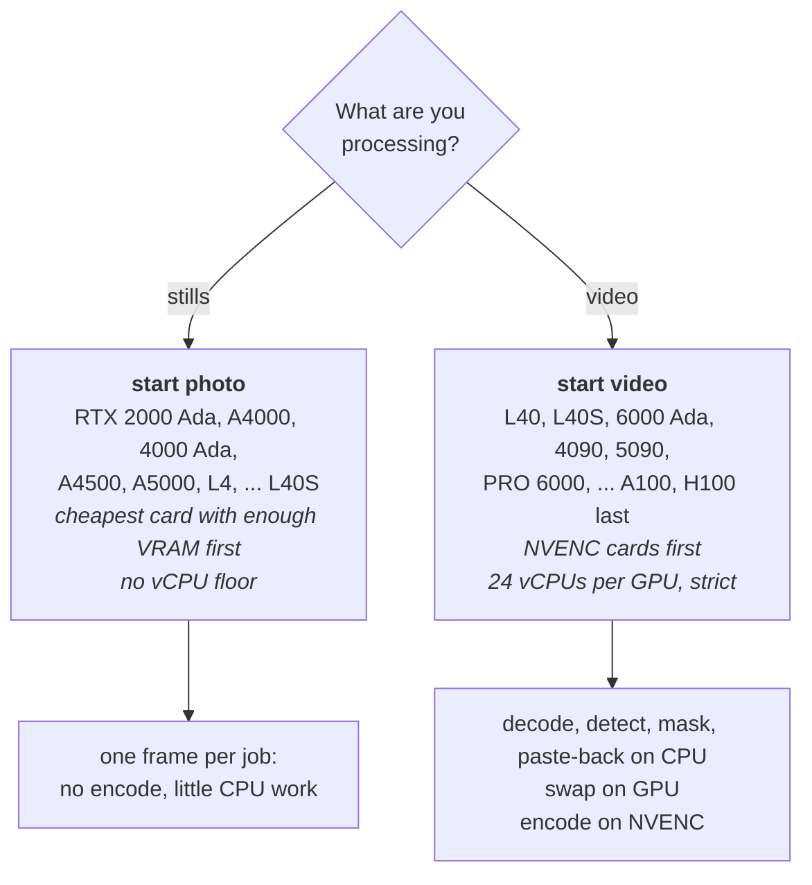

<h1 align="center">
  
  
  
  
  <br>
  <br>
  <code><strong>facefusion</strong></code>
</h1>

<p align="center">
  
  
  
  
  
</p>

<p align="center">
  <a href="https://github.com/facefusion/facefusion">FaceFusion</a> 3.9.2 on a RunPod GPU pod.<br>
  The face models are baked into the image, so the first job starts without downloads.
</p>

> **Use it responsibly.** FaceFusion is a face swapper. Use it only on faces
> you have consent to use, and follow FaceFusion's OpenRAIL-AS license, whose
> use restrictions apply to your image. FaceFusion's content analyser is
> active, and its models are baked in with the rest.

---

## Quick Start

```bash
cd runpod/pods/facefusion
cp pod.env.example pod.env          # set RUNPOD_IMAGE to your registry
../../pod-kit/build.sh .
../../pod-kit/pod.sh . setup
../../pod-kit/pod.sh . start photo  # stills: cheapest card first
../../pod-kit/pod.sh . start video  # video: NVENC cards, 24+ vCPUs per GPU
# open http://127.0.0.1:17960
../../pod-kit/pod.sh . stop
```

Outputs go to `/workspace/output`. Copy them off with `scp` (`pod.sh . status`
prints the command) before you stop the pod.

<br>

---

## What Is in the Image

| Component | Version / detail |
|---|---|
| **FaceFusion** | 3.9.2, cloned at the tag |
| **onnxruntime-gpu** | 1.31.0 (CUDA 13), no torch |
| **Models** (baked) | face swappers (hyperswap 1a/1b/1c, simswap 512, inswapper 128), detectors (yoloface, retinaface, scrfd), landmarker, recognizer, occluder and parser masks, enhancers (gfpgan, gpen 2048, codeformer), the support models every run loads, and the content analyser |
| **FFmpeg** | 8.1 with NVENC (Ubuntu 22.04's 4.4 is too old for FaceFusion 3.9) |
| **sshd, cloudflared** | access ([`docs/access.md`](../../docs/access.md)) |

> **Licenses:** model licenses vary, and several face swappers are
> non-commercial. The recipe downloads them into your own image: check each
> model's terms, and keep the image private.

<br>

---

## Photo and Video Lists

`pod.env.example` defines two GPU lists, and `start <list>` picks one.



| | `photo` | `video` |
|---|---|---|
| **GPU order** | cheapest card with enough VRAM first | NVENC cards first; A100 and H100 (no NVENC) last |
| **vCPU floor** | none | 24 per GPU (`RUNPOD_MIN_VCPU_PER_GPU_VIDEO`), strict: start gives up rather than take a smaller host |
| **Why** | a still is one frame: no encode, little CPU work | face detection, masks and paste-back run on the CPU, so on a host with few vCPUs the GPU waits |
| **Encoder** | n/a | `start.sh` makes `h264_nvenc` the UI's default when the GPU has one |

[`docs/gpu-selection.md`](../../docs/gpu-selection.md) covers how the floor
and the lists interact with RunPod's placement.

<br>

---

## Uploads

FaceFusion's Gradio UI sends each upload as one request.

| Path | Works at any size | Survives a dropped connection |
|---|---|---|
| SSH tunnel (`127.0.0.1:17960`) | yes | no, a drop restarts the upload |
| Cloudflare Tunnel | no, refused over 100 MB | no |
| `scp` into the pod, then use the path | yes | per file |

For large videos, copy them in and point FaceFusion at the path:

```bash
scp -P <port> clip.mp4 root@<host>:/workspace/
```

<br>

---

## Tuning for Hard Video

Starting points to try on the worst frames with `face_debugger` on (not
measured results):

| Problem | Try |
|---|---|
| Side profiles, detection drops out | `--face-detector-model many`, `--face-detector-score 0.35`, `--face-tracker-score 0.25` |
| Hands, hair, glasses or a mic over the face | `--face-mask-types box occlusion` |
| Swap bleeds into hair or background | add `region` to the mask types; raise `--face-mask-padding` |
| Visible seam at the edge | `--face-mask-blur 0.4` to `0.5` |
| Flicker or identity jumping between frames | `--face-tracker-score 0.2` to `0.3` |
| Wrong person swapped | `--face-selector-mode reference`, a clear frontal reference frame, lower `--reference-face-distance` |
| Soft swap on a close face | `--face-swapper-pixel-boost 512x512` or higher |
| Restored face looks plastic | lower `--face-enhancer-blend` to 50 to 60 |

`face_detector_angles` rotates the frame in-plane: it finds tilted or
upside-down heads, not profiles.

**Source photos:** 3 to 8 sharp, well-lit photos of the same person, frontal
to three-quarter view, nothing over the face, with some variety in light and
expression. Leave out profiles, blurred shots and beauty filters.

<br>

---

## Status

| Job | GPU | Input | Time | Encode |
|---|---|---|---|---|
| Video | RTX PRO 6000 | FaceFusion's example `source.jpg`, 240p 270-frame clip | about 60 s including model loading | `h264_nvenc` |
| Photo | RTX PRO 6000 | FaceFusion's example assets | about 30 s | n/a |

Both ran headless over SSH. The browser UI was not exercised.
