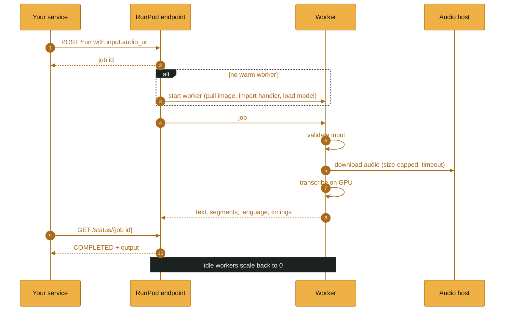
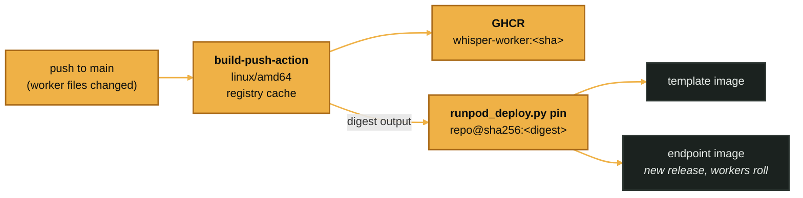

<h1 align="center">
  
  
  
  <br>
  <br>
  <code><strong>whisper-worker</strong></code>
</h1>

<p align="center">
  
  
  
  
</p>

<p align="center">
  Speech to text on a RunPod serverless endpoint with <a href="https://github.com/SYSTRAN/faster-whisper">faster-whisper</a> large-v3.<br>
  Scales to zero, with the weights baked into the image.<br>
  A job sends an audio URL and gets back the text and timed segments.
</p>

---

## Quick Start

```bash
cd runpod/serverless/whisper

# 1. build and push (linux/amd64; on an ARM Mac this emulates and is slow)
docker buildx build --platform linux/amd64 --provenance=false \
  -t ghcr.io/your-user/gpu-cloud-ai-recipes/whisper-worker:v1 --push .

# 2. spec: copy and set the image (and registryName for a private image)
cp endpoint.example.json endpoint.json

# 3. create the template and the endpoint
export RUNPOD_API_KEY=...        # from a secret store, not your shell history
python3 ../deploy/runpod_deploy.py apply endpoint.json

# 4. a test job (the first one waits for a cold worker to pull the image)
python3 ../deploy/runpod_deploy.py run endpoint.json test_input.json
```

<br>

---

## Why This Worker

The parts of this worker that carry over to any serverless worker:

<table>
<tr>
<td valign="top">

### Image


- **Weights baked into the image** in their own `--link` layer, pinned by commit (`Dockerfile`). Changing the code never re-downloads them.
- **The build checks the stack**: it decodes a generated WAV and loads the model on the CPU, so a broken dependency or model fails the image build, not a billed worker.

</td>
</tr>
<tr>
<td valign="top">

### Handler


- **The model loads at import**, once per worker. If it cannot load, the worker fails at start and you see that in RunPod's worker logs, instead of every job failing.
- **Input validated at the edge** (`validation.py`, unit-tested without a GPU). A bad input returns an `error` and does not retry.
- **Out-of-memory errors replace the worker** (`refresh_worker`). CUDA can be left broken after an out-of-memory error, and every later job on that worker would fail the same way.
- **Plain JSON out**: timestamps and probabilities are cast to plain floats, rounded to milliseconds.

</td>
</tr>
</table>

<br>

---

## How a Job Runs



<br>

---

## Input and Output

```json
{"input": {"audio_url": "https://...", "language": "en", "task": "transcribe",
           "beam_size": 5, "vad_filter": true, "word_timestamps": false}}
```

| Field | Required | Default | Accepts |
|---|---|---|---|
| `audio_url` | yes | | an `http` or `https` URL |
| `language` | no | detected | a language code such as `en` |
| `task` | no | `transcribe` | `transcribe`, or `translate` for English text from another language |
| `beam_size` | no | `5` | integer 1 to 10 |
| `vad_filter` | no | `true` | skip silence before decoding |
| `word_timestamps` | no | `false` | add per-word times and probabilities to each segment |

```json
{"language": "en", "language_probability": 0.99, "duration": 11.0,
 "text": "And so my fellow Americans ...",
 "segments": [{"start": 0.0, "end": 10.9, "text": "...", "words": [...]}],
 "processing_s": 0.8}
```

A bad input or an unreachable URL returns `{"error": "..."}`.

> **The worker fetches whatever URL a job names.** Put the endpoint behind
> your own service if untrusted callers can submit jobs, and do not give the
> worker credentials it does not need.

### Environment

| Env (template) | Default | Purpose |
|---|---|---|
| `MAX_AUDIO_MB` | `500` | refuse larger downloads |
| `DOWNLOAD_TIMEOUT_S` | `120` | per download |
| `WHISPER_COMPUTE_TYPE` | `float16` | `int8_float16` halves VRAM at a small accuracy cost |

<br>

---

## Deploying and Updating

The endpoint spec, [`endpoint.example.json`](endpoint.example.json), names the
template and the endpoint and holds no secrets: `envFromShell` takes the
names of secret values, which come from your shell at create time. For a
private image, set `registryName` to a registry auth created once in the
RunPod console (Settings > Container Registry Auth).

| Spec field | Example | Meaning |
|---|---|---|
| `template.image` | `ghcr.io/your-user/gpu-cloud-ai-recipes/whisper-worker:v1` | what workers run (later pinned by digest) |
| `template.disk` | `20` | container disk, GB |
| `endpoint.workers` | `{"min": 0, "max": 2}` | scale to zero, at most two workers |
| `endpoint.scaling` | `REQUEST_COUNT`, `1` | one worker per queued job |
| `endpoint.timeout` | `600000` | job timeout, ms |
| `endpoint.flashboot` | `FLASHBOOT` | reuse a finished worker's container |
| `endpoint.gpu.pools` | `AMPERE_24`, `ADA_24`, `AMPERE_48` | GPU pools in rent priority |
| `endpoint.gpu.minCudaVersion` | `12.8` | driver floor, matching the base image |

### Commands

| Command | Does |
|---|---|
| `runpod_deploy.py apply <spec>` | creates a missing template or endpoint. On an existing endpoint it updates `workers`, `scaling`, `timeout`, `flashboot` and `gpu`. It never changes the image (that is `pin`) and never rewrites a template's env |
| `runpod_deploy.py pin <spec> <repo@sha256:...>` | points the template, then the endpoint, at an image digest, which rolls the workers |
| `runpod_deploy.py status <spec>` | image, latest release, workers (with `isStale`) |
| `runpod_deploy.py run <spec> <input.json>` | submits a job and waits for its result |

### Updates from CI

[`build-and-pin.example.yml`](build-and-pin.example.yml) is a GitHub Actions
workflow that builds on every push that changes the worker and pins the
endpoint to the new digest:



Pinning by digest matters: pushing a new image under the same tag does not
make RunPod pull it. [`docs/serverless.md`](../../docs/serverless.md) covers
why, along with releases, GPU pools and cold starts.

### Local test

With an NVIDIA GPU and the image, the RunPod SDK's test server runs the
handler locally:

```bash
docker run --gpus all -p 8000:8000 <image> \
  python -u /app/handler.py --rp_serve_api --rp_api_host 0.0.0.0
```

<br>

---

## Files

| File | Purpose |
|---|---|
| [`Dockerfile`](Dockerfile) | CUDA 12.8 + cuDNN 9 base, Python 3.12 venv, the model in its own layer, build-time decode and load check |
| [`handler.py`](handler.py) | the job handler: download, transcribe, return segments |
| [`validation.py`](validation.py) | input parsing and limits |
| [`requirements.txt`](requirements.txt) | pinned `runpod`, `faster-whisper`, `ctranslate2`, `av` |
| [`test_input.json`](test_input.json) | a sample job (a short public-domain clip) |
| [`endpoint.example.json`](endpoint.example.json) | template and endpoint spec for `deploy/runpod_deploy.py` (pools checked against `GET /v2/catalog/gpus`) |
| [`build-and-pin.example.yml`](build-and-pin.example.yml) | GitHub Actions: build, push, pin the digest |
| [`tests/`](tests/) | validation unit tests |

<br>

---

## Status

| Step | Result |
|---|---|
| Image build | built, with the decode and model-load checks passing |
| Handler on a GPU | run on an L4 through the SDK's `--test_input` mode: model loaded in about 2 s, the sample clip transcribed correctly with word timestamps in about 1.3 s |
| `runpod_deploy.py apply` | created a template |
| Endpoint, `pin`, `run` | not yet run |
